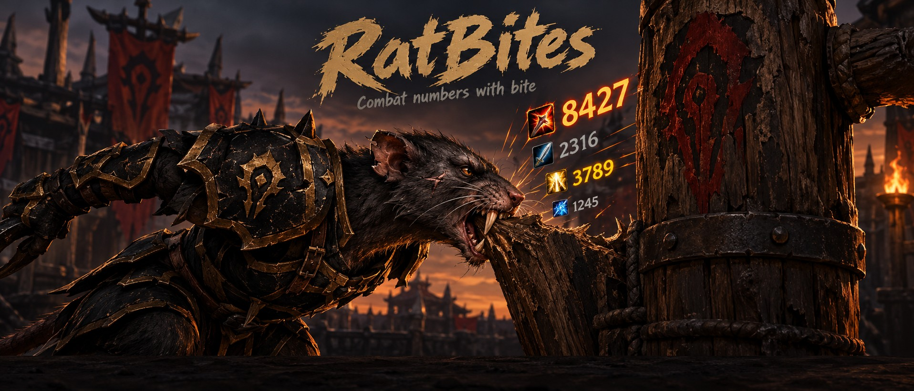
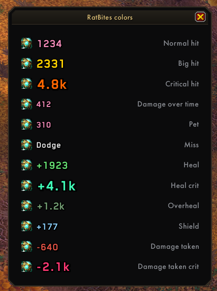

  

  <b>Combat numbers with spell icons for World of Warcraft 3.3.5a.</b> 
  Your hits and heals on each nameplate, what lands on you in its own box.

  
  
  
  

---

## What you see

- **Output, what you do:** every hit and heal rises over its target's nameplate with the spell's icon,
  or goes into **My box**. Heals land on the friend you healed however you cast them (raid frames,
  mouseover); friendly nameplates must be on, but you can hide their look in your nameplate addon.
- **Receiving, what lands on you:** heals, shields and hits on you (your self-heals too) go to the
  **Received box**, and can also float over your character.
- **Colours that tell you what happened:** grey hits, gold big hits, orange crits, green heals, mint
  heal crits, dim overheal, blue shields, red damage taken. Crits get a thick outline and bigger text.

## Features

| | |
|---|---|
| **Nameplates** | Numbers ride the enemy's or friend's plate, with ElvUI plates too. Hits landing together stack a line apart. |
| **Boxes** | My box and Received box, xCT style. Move and resize them; each has its own scroll direction, alignment, merge and line time. |
| **Merging** | In a box, the same spell again within a few seconds joins one line as a total with `x5`, like an AoE on five mobs. |
| **Shields** | Val'anyr (with its mace icon), Divine Aegis and Sacred Shield show their size; Power Word: Shield shows as *Shield*. |
| **Weapon icon** | Your auto-attacks show the weapon you have equipped. |
| **Animations** | Arc, Rise, Stay, Fountain or Fall, with sideways drift, travel distance and time on screen. |
| **Look** | Any font your addons share (ElvUI, SharedMedia), text and icon size, crits in your class colour. |
| **Filters** | Normal or critical hits, auto-attacks, spells, damage over time, heals and shields, misses, pet. |
| **Game numbers** | The game's own floating numbers turn off while RatBites runs and come back when you disable it. |

  

## Install

1. Download **RatBites.zip** from the latest release.
2. Unzip it into `World of Warcraft\Interface\AddOns\` so you have a **`RatBites`** folder.
3. Restart the game.

## Use

- `/bites` (or `/ratbites`), or click the rat on the minimap: settings
- `/bites test`: one number of each kind on your target
- `/bites colors`: every kind of number in its colour, as your settings draw it
- `/bites move`: unlock the boxes to move and resize them

## Notes

3.3.5a nameplates don't carry a unit id, so numbers are matched to plates by name. When several mobs
with the same name are on screen, your target always gets its numbers; the others keep the plate they
were last seen on. A heal on someone without a plate on screen goes to My box (or a column right of the screen's centre, or nowhere: your choice).

See [LICENSE](LICENSE) and [THIRD_PARTY_NOTICES.md](THIRD_PARTY_NOTICES.md).
